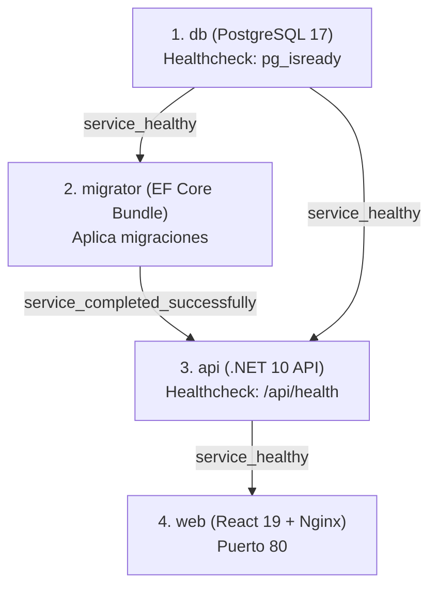

# Arquitectura del Sistema — Plataforma de Actas

## 1. Visión General del Proyecto

La **Plataforma de Actas** es una solución empresarial para la gestión integral del ciclo de vida, asignación física, custodia y control de activos tecnológicos y de hardware de una organización.

### Capacidades Principales
- **Gestión de Inventario de Hardware**: Registro de especificaciones técnicas (procesador, RAM, disco duro), estado operativo y cronograma de mantenimiento.
- **Actas Oficiales (Entrega y Devolución)**: Creación asistida con numeración secuencial (`ACTA-YYYY-XXXX`), captura de firma digital manuscrita, trazabilidad de estados (`Borrador` → `Firmada` → `Finalizada` / `Anulada`).
- **Generación de Documentos PDF y Sellado Criptográfico**: Generación institucional basada en norma **TI-FOR-ACTA-001 (Versión 3.2 / ISO 27001)** mediante QuestPDF y cálculo determinista de integridad mediante **SHA-256**.
- **Control de Acceso Basado en Roles (RBAC)**: Autenticación JWT con permisos granulares por módulo (`Administrador`, `Auditor`, `Gestor TI`, `Mensajero`).
- **Dashboard y Reportes Consolidados**: Métricas en tiempo real de equipos, entregas por mensajero, cronograma de mantenimientos y exportación de datos.

---

## 2. Estructura del Monorepo

```
plataforma-actas/
├── apps/
│   ├── api/                     # Backend ASP.NET Core 10 (Minimal APIs, Monolito Modular)
│   │   ├── Authorization/       # Handlers de permisos, constantes y políticas RBAC
│   │   ├── Infrastructure/      # DbContext, Proveedores de Almacenamiento, Seguridad SHA-256
│   │   │   ├── Persistence/     # PlataformaActasDbContext, Migrations, Seeder
│   │   │   ├── Security/        # Sha256IntegrityService
│   │   │   └── Storage/         # IFileStorageProvider, LocalFileStorageProvider
│   │   ├── Modules/             # Módulos de negocio (Vertical Slices autocontenidos)
│   │   │   ├── Actas/           # Entidades, repositorio, servicio, generador PDF, endpoints
│   │   │   ├── Auth/            # Autenticación JWT, tokens de recuperación, endpoints
│   │   │   ├── Dashboard/       # Métricas, KPIs, servicios analíticos, endpoints
│   │   │   ├── Equipment/       # Catálogo de hardware, inventario, mantenimientos
│   │   │   ├── Health/          # Healthcheck liviano (/api/health)
│   │   │   ├── Reportes/        # Consultas de reportes consolidados, endpoints
│   │   │   ├── Roles/           # Gestión de roles y permisos RBAC
│   │   │   └── Usuarios/        # Gestión de cuentas de usuario y credenciales
│   │   ├── Dockerfile           # Imagen de producción .NET 10
│   │   └── Program.cs           # Punto de entrada y configuración de pipeline
│   └── web-admin/               # Frontend SPA React 19 + TypeScript + Vite + Tailwind CSS
│       ├── src/                 # Componentes, vistas, stores, hooks y servicios API
│       ├── nginx.conf           # Configuración de Nginx para producción y proxy reverso
│       └── Dockerfile           # Imagen multi-stage (Node 22 -> Nginx 1.27)
├── database/                    # Contenedor PostgreSQL 17
│   ├── Dockerfile
│   └── README.md
├── docs/                        # Documentación técnica y registros de decisiones
│   └── adr/                     # Architectural Decision Records (ADRs)
├── infra/                       # Infraestructura y orquestación
│   └── docker/
│       ├── docker-compose.yml   # Orquestación de servicios (db, migrator, api, web)
│       └── .env.example
├── tests/                       # Proyectos de pruebas automatizadas
│   ├── PlataformaActas.Api.UnitTests/
│   └── PlataformaActas.Api.IntegrationTests/
├── tools/
│   └── migrator/                # Contenedor para ejecución de EF Core Migrations bundle
│       ├── Dockerfile
│       └── README.md
├── PlataformaActas.sln          # Solución .NET 10 principal
└── pnpm-workspace.yaml          # Configuración de workspace de aplicaciones web
```

---

## 3. Arquitectura del Backend (.NET 10)

El backend implementa un patrón de **Monolito Modular con Vertical Slices**. Cada módulo de negocio contiene todas las capas necesarias para su funcionamiento:

```
Modules/{NombreModulo}/
├── Data/
│   ├── Entities/                # Clases de dominio y entidades de persistencia
│   ├── Configurations/          # Mapeo Fluent API (IEntityTypeConfiguration<T>)
│   ├── I{Modulo}Repository.cs   # Interfaz de acceso a datos
│   └── {Modulo}Repository.cs    # Implementación con EF Core
├── Services/
│   ├── I{Modulo}Service.cs      # Interfaz de lógica de negocio
│   └── {Modulo}Service.cs       # Implementación de reglas y validaciones
├── Models/
│   ├── Dto/                     # Request y Response records inmutables
│   └── Mappers/                 # Métodos de extensión estáticos de mapeo
├── Endpoints/
│   └── {Modulo}Endpoints.cs     # Minimal APIs tipadas con RequirePermission
└── {NombreModulo}Module.cs      # Extensiones Add{Modulo}Module() y Map{Modulo}Module()
```

### Reglas de Diseño
1. **Entidad EF Core ≠ DTO de API**: Las entidades nunca se exponen directamente a los endpoints. Los mapeos son explícitos en la carpeta `Models/Mappers/`.
2. **Contratos e Interfaces**: Todo servicio y repositorio expone una interfaz (`I...Service`, `I...Repository`), permitiendo pruebas unitarias con mocks.
3. **Minimal APIs**: Cada grupo de rutas se mapea con filtros de seguridad y autorización granulares.

---

## 4. Persistencia y Esquema de Base de Datos

- **Manejador Relacional**: PostgreSQL 17.
- **ORM**: Entity Framework Core 10 (`Npgsql.EntityFrameworkCore.PostgreSQL`).
- **Fuente de Verdad**: Las migraciones de EF Core (`Infrastructure/Persistence/Migrations/`) son el único mecanismo de evolución de esquema.
- **Despliegue Determinista**: `tools/migrator/Dockerfile` compila un bundle binario ejecutable (`dotnet ef migrations bundle`) que se ejecuta antes del inicio del backend en contenedores.

---

## 5. Seguridad, RBAC e Integridad Digital

### Autenticación y Autorización
- **JWT (JSON Web Tokens)**: Clave simétrica HMAC-SHA256 con tiempo de expiración configurable.
- **Claims**: Contiene `NameIdentifier`, `Name`, `Email`, `Role` y claims repetidos de tipo `permiso`.
- **Autorización Declarativa**: Extensiones `.RequirePermission(Permissions.XXX)` en cada endpoint validan que el usuario posea el permiso requerido en sus claims.

### Integridad Criptográfica de Actas (SHA-256)
1. Al firmarse un acta, se genera el documento PDF oficial mediante **QuestPDF**.
2. El servicio `Sha256IntegrityService` computa el hash SHA-256 del contenido binario del PDF.
3. El hash se almacena en la columna `hash_sha256` de la tabla `actas_v2` y se estampa en el pie de página del documento para verificación de no repudio.

---

## 6. Orquestación con Docker Compose

El archivo `infra/docker/docker-compose.yml` orquesta los cuatro servicios con dependencias estrictas por estado de salud:



---

## 7. Instrucciones de Compilación y Ejecución

### Requisitos Previos
- .NET SDK 10.0+
- Node.js 22+ y pnpm / npm
- PostgreSQL 17 o Docker Desktop

### Ejecución Local del Backend
```bash
# Restaurar y compilar solución completa
dotnet build PlataformaActas.sln

# Ejecutar API
cd apps/api
dotnet run
```

### Ejecución Local del Frontend
```bash
cd apps/web-admin
npm install
npm run dev
```

### Despliegue con Docker Compose
```bash
cd infra/docker
docker compose up --build -d
```
