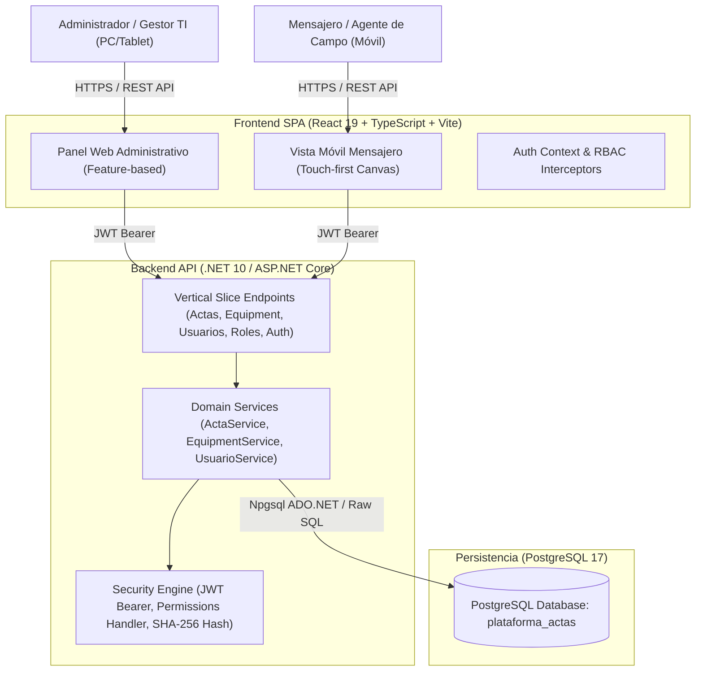

# 🏛️ ARQUITECTURA GENERAL DEL SISTEMA - PLATAFORMA DE ACTAS

## 1. Resumen Ejecutivo
La **Plataforma de Actas** es una solución empresarial diseñada para la gestión del ciclo de vida, entrega física en campo y certificación de custodia de activos de hardware y equipos tecnológicos mediante actas electrónicas firmadas digitalmente.

---

## 2. Diagrama de Contenedores (C4 Model)

---

## 3. Arquitectura del Backend (.NET 10 - Vertical Slices)
El backend implementa una arquitectura modular organizada por **Features**:
- `Features/Actas/`: Gestión del ciclo documental, generación de identificadores, firma manuscrita y validación de actas origen para devoluciones.
- `Features/Equipment/`: Catálogo maestro de hardware, especificaciones técnicas, custodia y disponibilidad operativa.
- `Features/Usuarios/`: Directorio de colaboradores, autenticación, control de accesos y hash BCrypt.
- `Features/Roles/`: Definición de perfiles y asignación dinámica de permisos.
- `Features/Auth/`: Emisión, validación y extracción de Claims JWT.

---

## 4. Arquitectura del Frontend (React 19 + Vite)
El frontend organiza sus componentes bajo el patrón **Feature Folders**:
- `features/actas/`: Componentes de visualización, creación asistida (`NewActaForm`) y detalle (`ActaDetail`).
- `features/equipment/`: Listados paginados, filtros multi-criterio (`EquipmentFilters`), modales de alta/edición (`EquipmentFormModal`).
- `features/mensajero/`: Vistas especializadas y adaptables para dispositivos móviles de mensajería con captura táctil de trazos.
- `features/auth/`: Formularios de autenticación, restablecimiento de contraseña y utilidades de verificación RBAC (`hasPermission`).
