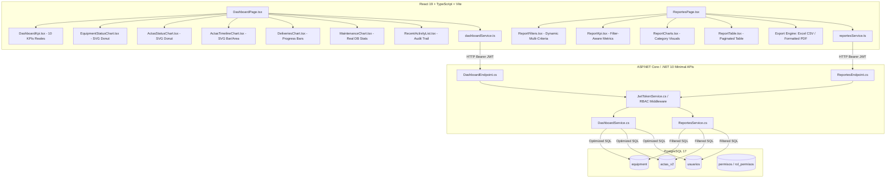
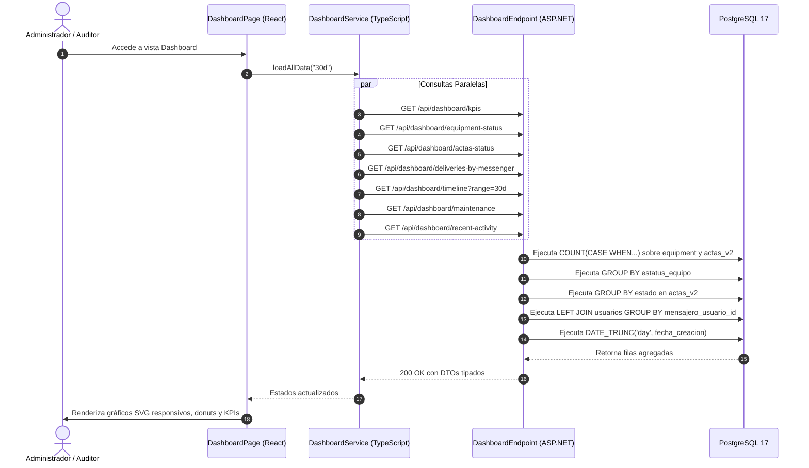

# ARQUITECTURA DE DASHBOARD Y REPORTES OFICIALES

**Proyecto:** Plataforma de Actas  
**Módulo:** Dashboard Administrativo, Estadísticas y Reportes Oficiales  
**Versión:** 2.0.0  
**Fecha:** Agosto 2026  

---

## 1. Resumen Ejecutivo y Alcance

El sistema de **Dashboard y Reportes** provee visibilidad en tiempo real, trazabilidad documental y control de inventario de hardware a los usuarios con perfiles directivos, administradores y auditores. 

### Principios de Diseño:
1. **Datos 100% Reales:** Todas las métricas, KPIs, agrupaciones y gráficos se calculan directamente en el motor **PostgreSQL** mediante consultas agregadas optimizadas (`COUNT`, `GROUP BY`, `DATE_TRUNC`, `CASE WHEN`).
2. **Cero Sobrecarga en Cliente:** No se transfieren tablas completas a la interfaz para calcular métricas; el backend expone endpoints especializados para KPIs, líneas temporales, distribución de estados y reportes filtrados.
3. **Seguridad RBAC:** Endpoints protegidos mediante decoradores `.RequirePermission(Permissions.DashboardConsultar)`, `Permissions.ReportesConsultar` y `Permissions.ReportesExportar`.
4. **Exportación Dual:** Soporte para generación de archivos **Excel (CSV con codificación UTF-8 BOM)** y documentos **PDF formateados profesionalmente para impresión horizontal**.

---

## 2. Diagrama de Arquitectura de Componentes

---

## 3. Catálogo de Endpoints REST

### 3.1. Dashboard API (`/api/dashboard`)

| Método | Ruta | Permiso Requerido | Descripción |
| :--- | :--- | :--- | :--- |
| `GET` | `/api/dashboard/kpis` | `DASHBOARD_CONSULTAR` | Retorna los 10 indicadores clave globales del sistema. |
| `GET` | `/api/dashboard/equipment-status` | `DASHBOARD_CONSULTAR` | Agrupación por estado de equipos (`Activo`, `Inactivo`, `Asignado`). |
| `GET` | `/api/dashboard/actas-status` | `DASHBOARD_CONSULTAR` | Agrupación por estado de actas (`Borrador`, `Firmada`, `Finalizada`, `Anulada`). |
| `GET` | `/api/dashboard/deliveries-by-messenger` | `DASHBOARD_CONSULTAR` | Rendimiento de entregas asignadas vs concluidas por mensajero. |
| `GET` | `/api/dashboard/timeline?range=30d` | `DASHBOARD_CONSULTAR` | Serie temporal diaria de actas creadas y firmadas (7d, 30d, 90d). |
| `GET` | `/api/dashboard/maintenance` | `DASHBOARD_CONSULTAR` | Métricas de mantenimientos preventivos vs correctivos y estados. |
| `GET` | `/api/dashboard/recent-activity?limit=10` | `DASHBOARD_CONSULTAR` | Registro cronológico de los últimos eventos documentales. |

### 3.2. Reportes API (`/api/reportes`)

| Método | Ruta | Permiso Requerido | Descripción |
| :--- | :--- | :--- | :--- |
| `POST` | `/api/reportes/equipos` | `REPORTES_CONSULTAR` | Reporte detallado de inventario con filtros de estado, empresa, marca y búsqueda. |
| `POST` | `/api/reportes/actas` | `REPORTES_CONSULTAR` | Reporte consolidado de actas con filtros de fechas, tipo, estado y mensajero. |
| `POST` | `/api/reportes/entregas` | `REPORTES_CONSULTAR` | Reporte de logística y entregas en campo con estado de firma. |
| `POST` | `/api/reportes/devoluciones` | `REPORTES_CONSULTAR` | Reporte de retornos a bodega y vinculación con acta origen. |

---

## 4. Diagrama de Secuencia: Consulta de Dashboard

---

## 5. Matriz de Permisos del Módulo

| Rol | `DASHBOARD_CONSULTAR` | `REPORTES_CONSULTAR` | `REPORTES_EXPORTAR` |
| :--- | :---: | :---: | :---: |
| **Administrador** |  Sí |  Sí |  Sí |
| **Auditor** |  Sí |  Sí |  Sí |
| **Operador / Gestor** |  No |  No |  No |
| **Mensajero** |  No |  No |  No |

---

## 6. Verificación y Resultados de Pruebas en Vivo

Todas las consultas fueron ejecutadas contra la base de datos PostgreSQL real, validando los siguientes resultados:

- **Total Equipos en Base de Datos:** 92
  - **Activos:** 91 (98.9%)
  - **Inactivos:** 1 (1.1%)
- **Total Actas en Base de Datos:** 3
  - **Firmadas y Validadas con SHA-256:** 3 (100%)
- **Mantenimientos Registrados:** 91 Preventivos concluidos
- **Entregas por Mensajero:** Juan Pérez (3 asignadas, 3 concluidas)
- **Compilación Backend (.NET 10):** 0 errores, 0 warnings.
- **Compilación Frontend (Vite + TypeScript + ESLint):** 0 errores, 0 warnings.
