# 🗄️ MODELO ENTIDAD-RELACIÓN (POSTGRESQL 17)

## 1. Diagrama Entidad-Relación

```mermaid
erDiagram
    USUARIOS ||--o{ ACTAS : "crea / recibe / entrega"
    USUARIOS ||--o{ USUARIO_ROLES : "posee"
    ROLES ||--o{ USUARIO_ROLES : "asignado_a"
    ROLES ||--o{ ROL_PERMISOS : "contiene"
    PERMISOS ||--o{ ROL_PERMISOS : "asociado_a"
    EQUIPMENT ||--o{ ACTAS : "asociado_a"
    ACTAS ||--o| ACTAS : "acta_origen_id (Devolución)"
    ACTAS ||--o{ ACTA_OBSERVATIONS : "tiene"
    ACTAS ||--o{ ACTA_SIGNATURES : "registra"
    ACTAS ||--o{ ACTA_STATUS_HISTORY : "registra_historial"

    USUARIOS {
        int Id PK
        string Nombre
        string Apellido
        string UsuarioRed UK
        string Correo UK
        string Proceso
        bool Activo
        string PasswordHash
        datetime UltimoAcceso
        datetime FechaCreacion
    }

    ROLES {
        int Id PK
        string Nombre UK
        string Descripcion
        bool Activo
        datetime FechaCreacion
    }

    PERMISOS {
        int Id PK
        string Nombre UK
        string Modulo
        string Descripcion
        bool Activo
    }

    EQUIPMENT {
        uuid id PK
        string inventory_key UK
        string nombre_equipo
        string empresa
        string asignado_a
        string proveedor
        string marca
        string procesador
        string disco_duro
        string memoria_ram
        string departamento
        string estatus_equipo
        bool acta_entregada
    }

    ACTAS {
        uuid id PK
        string numero_acta
        uuid equipment_id FK
        int usuario_id FK
        int destinatario_usuario_id FK
        int mensajero_usuario_id FK
        bool acta_entregada
        string estado
        string tipo_acta
        uuid acta_origen_id FK
        datetime fecha_firma
        datetime fecha_creacion
        datetime fecha_anulacion
        datetime fecha_finalizacion
        jsonb form_data_json
        string hash_sha256
        string motivo_anulacion
        jsonb signature_data_json
    }
```

---

## 2. Reglas de Integridad Referencial y Estado
- **`tipo_acta`**: Valores válidos: `'Entrega'` | `'Devolución'`.
- **`estado`**: Valores válidos: `'Borrador'` ➔ `'Firmada'` ➔ `'Finalizada'` (o `'Anulada'`).
- **Integridad de Devolución**: Un acta de tipo `'Devolución'` exige obligatoriamente un `acta_origen_id` correspondiente a un acta de entrega previa en estado `'Firmada'`.
- **Sincronización Automática con `equipment`**:
  - Al firmar una **Entrega**: `equipment.estatus_equipo` pasa a `'Asignado'`, `asignado_a` se llena con el nombre del destinatario y `acta_entregada = true`.
  - Al firmar una **Devolución**: `equipment.estatus_equipo` pasa a `'Activo'`, `asignado_a` se establece en `NULL` y `acta_entregada = false`.
